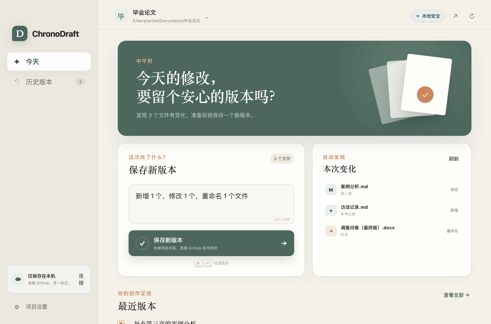

<div align="center">

# ChronoDraft

### 不学 Git，也能保存每一版作品。

**Version control for writers — without learning Git.**

给写作者、学生和研究者使用的本地版本时光机。

[⬇️ **下载：苹果芯片 Mac**](https://github.com/zhazhahuiyuxiaoxiao/chronodraft/releases/download/v0.1.1/ChronoDraft-0.1.1-arm64.dmg) ·
[⬇️ **下载：Intel Mac**](https://github.com/zhazhahuiyuxiaoxiao/chronodraft/releases/download/v0.1.1/ChronoDraft-0.1.1-x64.dmg) ·
[⬇️ **下载：Windows**](https://github.com/zhazhahuiyuxiaoxiao/chronodraft/releases/download/v0.1.1/ChronoDraft-Setup-0.1.1-x64.exe) ·
[⬇️ **下载：Linux**](https://github.com/zhazhahuiyuxiaoxiao/chronodraft/releases/download/v0.1.1/ChronoDraft-0.1.1-x86_64.AppImage)

</div>



## 下载与安装

| 你的电脑 | 下载 |
| --- | --- |
| Mac，芯片显示“Apple M…” | [下载苹果芯片版 `.dmg`](https://github.com/zhazhahuiyuxiaoxiao/chronodraft/releases/download/v0.1.1/ChronoDraft-0.1.1-arm64.dmg) |
| Mac，芯片显示“Intel” | [下载 Intel 版 `.dmg`](https://github.com/zhazhahuiyuxiaoxiao/chronodraft/releases/download/v0.1.1/ChronoDraft-0.1.1-x64.dmg) |
| Windows 10 / 11（64 位） | [下载安装程序 `.exe`](https://github.com/zhazhahuiyuxiaoxiao/chronodraft/releases/download/v0.1.1/ChronoDraft-Setup-0.1.1-x64.exe) |
| Linux（64 位） | [下载 `.AppImage`](https://github.com/zhazhahuiyuxiaoxiao/chronodraft/releases/download/v0.1.1/ChronoDraft-0.1.1-x86_64.AppImage) |

不知道自己的 Mac 芯片？点击屏幕左上角的苹果图标，再点“关于本机”即可查看。

> [!IMPORTANT]
> **当前是未签名预览版。** Mac 可能提示“无法验证开发者”，Windows 可能提示“未知发布者”。请只从本仓库下载；如果不想绕过系统提醒，可以等待以后提供签名版本。

### Mac 安装

1. 打开下载的 `.dmg` 文件，把 ChronoDraft 拖进“应用程序”。
2. 在“应用程序”中打开 ChronoDraft。如果出现安全提醒，先关闭提醒。
3. 打开“系统设置”→“隐私与安全”，向下找到 ChronoDraft，点击**“仍要打开”**。
4. 输入电脑密码，再点击“打开”。以后就可以正常双击启动。

### Windows 安装

1. 打开下载的 `.exe` 文件，按照画面提示安装。
2. 如果出现 Windows 保护提醒，确认文件来自本仓库后，点击“更多信息”。
3. 选择“仍要运行”。

### Linux 安装

下载 `.AppImage` 后，在文件属性中勾选“允许作为程序执行”，然后双击打开。

## 你是否也有这些文件？

```text
毕业论文-最终版.docx
毕业论文-最终版2.docx
毕业论文-真的最终版.docx
毕业论文-最后再改一次.docx
```

Git 能解决这个问题，但 Repository、Commit、Branch、Push 又制造了新的问题。

ChronoDraft 把它们藏起来，只留下写作者真正需要的四件事：

- **保存新版本**：自动记录整个文件夹的变化。
- **查看历史**：用时间线找到任何一次保存。
- **安全恢复**：恢复旧版本前，先自动备份现在的内容。
- **云端备份**：可选同步到 GitHub，断网也能先保存在本机。

## 三步开始

1. 打开 ChronoDraft，选择论文、小说或笔记文件夹。
2. 修改完文件，用一句话描述这次变化。
3. 点击 **保存新版本**。

第一次使用不需要服务器、Docker、数据库或付费账号。ChronoDraft 会在所选文件夹中创建标准 Git 历史，但界面不会要求你学习 Git。

## 为什么它对小白更友好？

| 常见 Git 工具 | ChronoDraft |
| --- | --- |
| 暂存、提交、推送是三个动作 | 一个“保存新版本”按钮 |
| 显示 `non-fast-forward` 等错误 | 告诉你本地版本是否安全、下一步做什么 |
| 恢复操作容易覆盖当前内容 | 恢复前自动保存当前状态 |
| 要求理解分支和远端 | 第一版只使用一个主版本线 |
| 可能要求粘贴 Token 或私钥 | 凭据交给系统 Git，应用不读取私钥 |

## GitHub 云端备份

本地保存完全不依赖 GitHub。需要异地备份时：

1. 在 GitHub 创建一个空的私有仓库。
2. 在 ChronoDraft 中点击 **连接 GitHub**。
3. 粘贴仓库的 HTTPS 地址。

ChronoDraft 不保存密码、Token 或 SSH 私钥。当前预览版使用电脑上已有的系统 Git 凭据；更直观的 GitHub 浏览器登录正在规划中。

## 支持哪些文件？

任何文件都可以保存版本，包括 Markdown、LaTeX、纯文本、图片和 Word 文档。

需要注意：Git 能完整保存 `.docx` 的每一版，但暂时不能像 Markdown 一样显示逐段文字差异。Word 文本对比会在后续版本加入。

## 本地开发

需要 Node.js 20+ 和 Git：

```bash
git clone https://github.com/zhazhahuiyuxiaoxiao/chronodraft.git
cd chronodraft
npm install
npm test
npm run dev
```

完整验证：

```bash
npm run check
npm test
```

## 当前状态

ChronoDraft 目前是 **0.1.1 早期预览版**。核心本地保存、历史、安全恢复和 GitHub 推送已经可用。当前安装包未做开发者签名；一键登录、敏感文件扫描和 Word 对比仍在规划中。

欢迎提交 Issue，尤其欢迎不熟悉 Git 的写作者讲述真实使用障碍。开发说明见 [docs/DEVELOPMENT.md](docs/DEVELOPMENT.md)。

## 路线图

- [ ] GitHub 浏览器一键登录
- [ ] 上传前扫描 `.env`、私钥、Token 等敏感文件
- [ ] `.docx` 逐段文本对比
- [ ] 非技术化的冲突处理界面
- [ ] macOS / Windows 代码签名与公证（条件允许时）
- [ ] 英文界面

## 安全与隐私

- 文件默认只留在本机。
- 没有分析统计，没有广告，没有后台服务器。
- 不收集 GitHub 密码、Token 或 SSH 私钥。
- 同步失败不会撤销已经成功的本地保存。
- 恢复历史前自动保留当前状态。

安全策略见 [SECURITY.md](SECURITY.md)。

## 贡献与许可

贡献指南见 [CONTRIBUTING.md](CONTRIBUTING.md)。项目采用 [MIT License](LICENSE)。

---

<div align="center">

如果 ChronoDraft 帮你少创建了一个“最终版2”，欢迎点一个 Star ⭐

</div>
