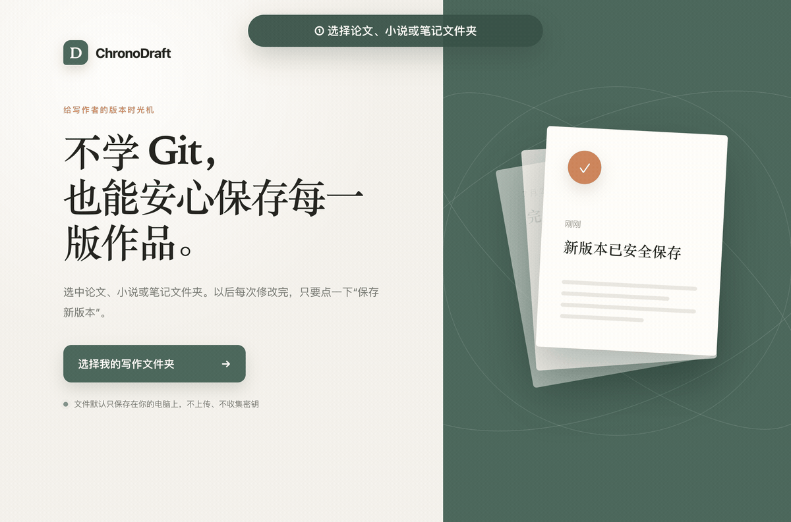

## 工程维护入口（2026-10-29）

本次按已提交 `main`（`288d65823867342cd591b1536826cd7e9e8af9e7`）补录工程与 OpenSpec 基线；下方原有产品介绍、署名和许可保留。历史验证记录不代表本次重新完成真机、云端或发布验收。

本地 Electron 写作版本工具；package.json 为 0.2.0，系统 Git 保存历史，GitHub 是可选备份。

- [工程基线与验收边界](docs/engineering-baseline.md)
- [项目开发约定](AGENTS.md)
- [OpenSpec 维护流程](openspec/README.md)

<div align="center">

# ChronoDraft

### 不学 Git，也能保存每一版作品。

**Version control for writers — without learning Git.**

给写作者、学生和研究者使用的本地版本时光机。

[⬇️ **下载：苹果芯片 Mac**](https://github.com/zhazhahuiyuxiaoxiao/chronodraft/releases/download/v0.2.0/ChronoDraft-0.2.0-arm64.dmg) ·
[⬇️ **下载：Intel Mac**](https://github.com/zhazhahuiyuxiaoxiao/chronodraft/releases/download/v0.2.0/ChronoDraft-0.2.0-x64.dmg) ·
[⬇️ **下载：Windows**](https://github.com/zhazhahuiyuxiaoxiao/chronodraft/releases/download/v0.2.0/ChronoDraft-Setup-0.2.0-x64.exe) ·
[⬇️ **下载：Linux**](https://github.com/zhazhahuiyuxiaoxiao/chronodraft/releases/download/v0.2.0/ChronoDraft-0.2.0-x86_64.AppImage)

</div>

## 22 秒看懂



## 下载与安装

| 你的电脑 | 下载 |
| --- | --- |
| Mac，芯片显示“Apple M…” | [下载苹果芯片版 `.dmg`](https://github.com/zhazhahuiyuxiaoxiao/chronodraft/releases/download/v0.2.0/ChronoDraft-0.2.0-arm64.dmg) |
| Mac，芯片显示“Intel” | [下载 Intel 版 `.dmg`](https://github.com/zhazhahuiyuxiaoxiao/chronodraft/releases/download/v0.2.0/ChronoDraft-0.2.0-x64.dmg) |
| Windows 10 / 11（64 位） | [下载安装程序 `.exe`](https://github.com/zhazhahuiyuxiaoxiao/chronodraft/releases/download/v0.2.0/ChronoDraft-Setup-0.2.0-x64.exe) |
| Linux（64 位） | [下载 `.AppImage`](https://github.com/zhazhahuiyuxiaoxiao/chronodraft/releases/download/v0.2.0/ChronoDraft-0.2.0-x86_64.AppImage) |

不知道自己的 Mac 芯片？点击屏幕左上角的苹果图标，再点“关于本机”即可查看。

> [!IMPORTANT]
> **当前是未签名预览版。** Mac 可能提示“无法验证开发者”，Windows 可能提示“未知发布者”。请只从本仓库下载；如果不想绕过系统提醒，可以等待以后提供签名版本。

### Mac 安装

1. 打开下载的 `.dmg` 文件，把 ChronoDraft 拖进“应用程序”。
2. 在“应用程序”中打开 ChronoDraft。如果出现安全提醒，先关闭提醒。
3. 打开“系统设置”→“隐私与安全”，向下找到 ChronoDraft，点击**“仍要打开”**。
4. 输入电脑密码，再点击“打开”。以后就可以正常双击启动。

### Windows 安装

1. 打开下载的 `.exe` 文件，按照画面提示安装。
2. 如果出现 Windows 保护提醒，确认文件来自本仓库后，点击“更多信息”。
3. 选择“仍要运行”。

### Linux 安装

下载 `.AppImage` 后，在文件属性中勾选“允许作为程序执行”，然后双击打开。

## 第一次打开：自动检查 Git

ChronoDraft 使用 Git 保存历史版本，但**不要求你学习 Git 命令**。软件启动时会自动检查：

- 已经安装：直接进入 ChronoDraft。
- 没有安装：显示中文说明和官方下载按钮；安装完成后点击“重新检测”即可。

请只使用 Git 官方入口：

| 你的电脑 | 官方安装页面 |
| --- | --- |
| Mac | [打开 Git for macOS 安装说明](https://git-scm.com/download/mac) |
| Windows | [下载 Git for Windows](https://git-scm.com/download/win) |
| Linux | [查看各发行版安装命令](https://git-scm.com/download/linux) |

想自己确认时，打开终端或命令提示符，输入：

```bash
git --version
```

看到类似 `git version 2.50.0` 就表示安装成功。Mac 用户第一次运行这条命令时，系统也可能直接弹出安装提示。

> [!NOTE]
> 当前安装包不静默安装 Git：系统软件安装需要管理员权限，而且不同电脑的安装方式不同。由用户确认 Git 官方安装程序更安全，也更容易排查问题。

## 你是否也有这些文件？

```text
毕业论文-最终版.docx
毕业论文-最终版2.docx
毕业论文-真的最终版.docx
毕业论文-最后再改一次.docx
```

Git 能解决这个问题，但 Repository、Commit、Branch、Push 又制造了新的问题。

ChronoDraft 把它们藏起来，只留下写作者真正需要的几件事：

- **保存新版本**：自动记录整个文件夹的变化。
- **自动安全快照**：有改动时每 10 分钟在本机保护一次，不打断写作，也不混入正式版本。
- **查看历史**：用可分页的时间线找到任何一次保存，并查看每个文件的改动。
- **标记里程碑**：把交稿、定稿等重要版本在时间线中醒目标出。
- **安全恢复**：恢复旧版本前，先自动备份现在的内容。
- **云端备份**：可选同步到 GitHub，断网也能先保存在本机。

ChronoDraft 会单独提示被 `.gitignore` 等规则排除的路径；这些内容不会进入版本，用户可以展开确认它们是否只是缓存或临时文件。

## 三步开始

1. 打开 ChronoDraft，选择论文、小说或笔记文件夹。
2. 修改完文件，用一句话描述这次变化。
3. 点击 **保存新版本**。

第一次使用不需要服务器、Docker、数据库或付费账号。ChronoDraft 会在所选文件夹中创建标准 Git 历史，但界面不会要求你学习 Git。

如果所选文件夹位于一个更大的 Git 项目中，ChronoDraft 会停止打开并提示选择项目根目录或独立文件夹，避免把选择范围之外的内容意外保存或同步。

## 为什么它对小白更友好？

| 常见 Git 工具 | ChronoDraft |
| --- | --- |
| 暂存、提交、推送是三个动作 | 一个“保存新版本”按钮 |
| 显示 `non-fast-forward` 等错误 | 告诉你本地版本是否安全、下一步做什么 |
| 恢复操作容易覆盖当前内容 | 恢复前自动保存当前状态 |
| 要求理解分支和远端 | 第一版只使用一个主版本线 |
| 可能要求粘贴 Token 或私钥 | 浏览器授权，应用不读取密码或私钥 |

## GitHub 云端备份

本地保存完全不依赖 GitHub。需要异地备份时：

1. 在 ChronoDraft 中点击 **连接 GitHub**，跟随三步中文向导通过浏览器登录。
2. 使用应用预填的信息创建私有仓库，或选择已有仓库。
3. 在 GitHub 明确授权后，回到 ChronoDraft 直接点击仓库卡片开启备份，无需复制地址。

向导右侧会用中文标出 GitHub 英文页面上需要确认的位置；手动 HTTPS 地址和 SSH 入口收在“高级设置”中。ChronoDraft 不要求输入密码、Token 或 SSH 私钥。浏览器登录产生的短期 Token 只在主进程中使用，并通过系统密钥库加密保存；系统 Git 与 SSH 方式仍可继续使用。开发配置详见[注册说明](docs/GITHUB_APP_SETUP.md)。

每次上传前，ChronoDraft 会检查完整正式版本历史中的敏感文件名、常见 Token / 私钥特征和大文件。检测结果只显示文件路径，不显示疑似密钥内容；需要用户明确确认后才会继续上传，超过 GitHub 100 MB 单文件限制的内容会直接停止上传。本地保存不受影响。

如果本机和云端改到了同一个文件，ChronoDraft 会退出同步、验证项目已经恢复到同步前状态，再列出冲突文件和两边的版本摘要。用户明确确认后，可以一键保留两边内容：本机冲突文件维持原样，云端内容在同一目录另存为 `文件名（云端副本）.扩展名`；若名字已经存在会自动编号，绝不覆盖已有副本。处理前还会重新检查本机、工作区和云端是否变化，过期的确认不会执行。

## 支持哪些文件？

任何文件都可以保存版本，包括 Markdown、LaTeX、纯文本、图片和 Word 文档。Markdown、LaTeX 和其他纯文本文件可以在版本详情中直接查看逐行增删；图片、Word 等二进制文件会提示已完整保存，但不把不可读的二进制内容当作文字展示。

需要注意：Git 能完整保存 `.docx` 的每一版，但暂时不能像 Markdown 一样显示逐段文字差异。Word 文本对比会在后续版本加入。

## 技术说明

ChronoDraft 不是需要部署服务器的前后端网站，而是一个本地 Electron 桌面应用：

- **界面**：HTML、CSS、原生 JavaScript
- **本地能力**：Electron 38、Node.js
- **版本保存**：自动检测电脑上的 Git；缺少时提供官方安装引导
- **通信方式**：Electron IPC，不经过 HTTP
- **端口**：普通使用不启动任何端口
- **数据**：文件和版本历史保存在本机，GitHub 仅作为可选备份

项目不需要 Docker、数据库或后台服务器。详细设计见 [技术架构文档](docs/ARCHITECTURE.md)。

## 本地开发

需要 Node.js 20+ 和 Git：

```bash
git clone https://github.com/zhazhahuiyuxiaoxiao/chronodraft.git
cd chronodraft
npm install
npm test
npm run dev
```

完整验证：

```bash
npm run verify
```

## 当前状态

ChronoDraft 目前是 **0.2.0 早期预览版**。核心本地保存、自动安全快照、里程碑、完整历史、文本差异、安全恢复、上传前隐私检查、双副本冲突处理和 GitHub 推送已经可用，并会在启动时自动检查 Git。GitHub App 浏览器登录、短期令牌刷新、系统安全存储和三步中文备份向导已经实现；向导会自动发现已授权且可写的仓库，不再要求粘贴地址。浏览器登录、指定仓库安装和首次推送已经用真实私有仓库完成验证。自动快照最多保留 30 个且不超过 7 天，只存在本机，不会自动上传。当前安装包未做开发者签名；Word 对比仍在规划中。

欢迎提交 Issue，尤其欢迎不熟悉 Git 的写作者讲述真实使用障碍。开发说明见 [docs/DEVELOPMENT.md](docs/DEVELOPMENT.md)，技术设计见 [docs/ARCHITECTURE.md](docs/ARCHITECTURE.md)。

## 路线图

- [x] GitHub 浏览器登录、系统安全存储、真实仓库安装和首次推送验证
- [x] 面向小白的三步中文备份向导与授权仓库自动发现
- [x] 上传前扫描 `.env`、私钥、Token 和 GitHub 大文件限制
- [ ] `.docx` 逐段文本对比
- [x] 非技术化的冲突处理界面（本机原件 + 云端副本）
- [ ] macOS / Windows 代码签名与公证（条件允许时）
- [ ] 英文界面

## 安全与隐私

- 文件默认只留在本机。
- 没有分析统计，没有广告，没有后台服务器。
- 不要求用户输入 GitHub 密码、Token 或 SSH 私钥；GitHub App 短期令牌只存在主进程和系统密钥库加密数据中，不进入项目或界面。
- 同步失败不会撤销已经成功的本地保存。
- 恢复历史前自动保留当前状态。

安全策略见 [SECURITY.md](SECURITY.md)。

## 贡献与许可

贡献指南见 [CONTRIBUTING.md](CONTRIBUTING.md)。准备转发项目时，可以直接使用[宣传图与中文发布文案](docs/marketing/LAUNCH_COPY.md)。项目采用 [MIT License](LICENSE)。

---

<div align="center">

如果 ChronoDraft 帮你少创建了一个“最终版2”，欢迎点一个 Star ⭐

</div>
