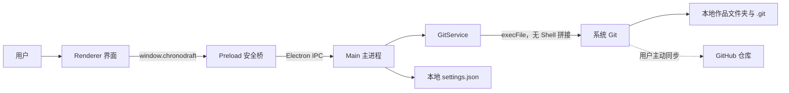

# ChronoDraft 技术架构

本文面向维护者和希望了解实现方式的开发者。普通用户不需要阅读本文，也不需要配置服务器或端口。

## 结论

ChronoDraft **不是传统的前后端分离网站**，而是一个本地 Electron 桌面应用。

- 从部署方式看：界面、业务逻辑和 Git 操作一起打包成一个应用，没有独立前端站点和后端服务。
- 从安全边界看：界面进程和系统能力进程彼此隔离，只能通过预先定义的 IPC 接口通信。
- 从数据位置看：作品、Git 历史和设置主要保存在用户电脑上；GitHub 只是可选的远端备份。



## 技术栈

| 部分 | 技术 | 用途 |
| --- | --- | --- |
| 桌面运行环境 | Electron 38.8.6 | 创建 macOS、Windows 和 Linux 桌面应用 |
| 主进程 | Node.js、CommonJS | 文件夹选择、设置存储、IPC 和系统能力 |
| 界面 | HTML、CSS、原生 JavaScript | 欢迎页、改动列表、历史和设置界面 |
| 安全桥 | Electron Preload、Context Bridge | 只向界面公开允许调用的功能 |
| 版本引擎 | 用户电脑上的 Git | 初始化仓库、提交、同步和恢复 |
| 自动测试 | Node.js Test Runner | 在临时目录中验证真实 Git 流程 |
| 打包 | electron-builder 26.15.3 | 生成 DMG、ZIP、EXE 和 AppImage |
| 持续集成 | GitHub Actions | 跨平台测试、构建、校验并上传 Release |

项目没有使用 React、Vue、Express、数据库或 Docker。

## 进程与职责

### Renderer：界面进程

目录：`src/renderer/`

Renderer 只负责显示状态和响应点击。它不能直接使用 Node.js、读取文件或执行 Git，页面也不能自行跳转到任意网址。

### Preload：安全桥

文件：`src/preload.js`

Preload 使用 `contextBridge` 暴露一个最小的 `window.chronodraft` API，例如选择文件夹、保存版本和恢复版本。Renderer 无法构造任意系统命令。

### Main：主进程

文件：`src/main.js`

Main 创建桌面窗口、处理文件夹选择、保存少量本地设置，并通过 `ipcMain.handle` 接收允许的操作。每次调用都返回统一的成功或中文错误结果。

窗口启用了以下隔离设置：

- `contextIsolation: true`
- `nodeIntegration: false`
- `sandbox: true`
- 禁止页面自行导航
- 禁止创建新窗口
- 外部链接仅允许 GitHub 官方域名

### GitService：版本业务层

文件：`src/git-service.js`

GitService 使用 Node.js `execFile` 调用系统 Git。参数以数组传递，不经过 Shell 字符串拼接，并关闭 Git 的终端凭据询问。

主要职责：

- 初始化 `main` 分支
- 解析新增、修改、删除、重命名和冲突状态
- 保存本地提交
- 读取历史记录
- 首次推送空仓库
- 获取远端更新后再推送
- 冲突时中止 rebase，不覆盖用户文件
- 恢复旧版本前自动保存当前内容

## 保存与同步流程

### 保存新版本

1. Renderer 调用 `saveVersion(message)`。
2. Preload 将请求转为 `project:save` IPC。
3. Main 将请求交给当前项目的 GitService。
4. GitService 检查作者信息和文件变化。
5. 执行 `git add -A` 和 `git commit`。
6. 本地提交成功后，才尝试可选的 GitHub 同步。
7. 即使网络或推送失败，本地版本仍然保留。

### 恢复历史版本

1. 验证目标提交是否真实存在。
2. 如果当前有未保存内容，先创建“恢复前自动备份”。
3. 从目标提交恢复工作区。
4. 将恢复结果保存为一个新提交，而不是删除历史。
5. 尝试同步；同步失败不影响本地恢复结果。

## 端口与网络

| 场景 | 端口 | 说明 |
| --- | --- | --- |
| 普通使用 | 无 | 不启动 HTTP 服务，不监听本机或公网端口 |
| `npm run dev` | 无 | 直接加载本地 HTML 文件 |
| 界面自动测试 | `127.0.0.1:9222` | 只有显式加入 `--remote-debugging-port=9222` 时才开启 |
| GitHub 同步 | 不监听端口 | 系统 Git 主动向 GitHub 发起出站连接；HTTPS 通常使用远端 443，SSH 通常使用远端 22 |

`9222` 仅用于开发截图和界面冒烟测试，不包含在发布版的默认启动参数中。

## 数据与凭据

- 作品文件和 `.git` 历史位于用户选择的项目文件夹。
- 最近打开的项目路径保存在 Electron 的用户数据目录下 `settings.json`。
- ChronoDraft 不保存 GitHub 密码、Token 或 SSH 私钥。
- GitHub 身份验证由系统 Git、macOS Keychain、Windows Credential Manager 或用户已有的 SSH 配置处理。
- 没有遥测、广告、账号数据库或后台服务器。

## 为什么不需要 Docker

Docker 适合运行服务器、数据库或一致的后端环境。ChronoDraft 直接操作用户本地文件和系统 Git，放进容器反而会增加文件权限、桌面界面和凭据访问难度，因此当前架构不需要 Docker。

## 目录结构

```text
src/
├── main.js                 Electron 主进程与 IPC
├── preload.js              安全 API 桥
├── git-service.js          Git 业务逻辑
└── renderer/               HTML / CSS / JavaScript 界面
test/
└── git-service.test.js     核心 Git 流程测试
scripts/
├── ui-smoke.mjs            界面冒烟测试与截图
└── generate-icons.mjs      多平台图标生成
build/                      应用图标与打包资源
.github/workflows/build.yml 跨平台构建与 Release 发布
```

## 当前边界

- 远端只接受 GitHub HTTPS 或 SSH 仓库地址。
- 预览版依赖用户电脑已有的 Git 和 GitHub 凭据。
- 只向用户展示单一主版本线，不提供分支管理界面。
- Word 文件可以完整保存每个版本，但尚不能逐段比较文字。
- 安装包尚未进行付费开发者签名和 Apple 公证。
- Electron 暂时按项目要求固定在 38.8.6；升级计划和安全注意事项见 [DEVELOPMENT.md](DEVELOPMENT.md)。
