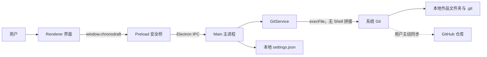

# ChronoDraft 技术架构

本文面向维护者和希望了解实现方式的开发者。普通用户不需要阅读本文，也不需要配置服务器或端口。

## 结论

ChronoDraft **不是传统的前后端分离网站**，而是一个本地 Electron 桌面应用。

- 从部署方式看：界面、业务逻辑和 Git 操作一起打包成一个应用，没有独立前端站点和后端服务。
- 从安全边界看：界面进程和系统能力进程彼此隔离，只能通过预先定义的 IPC 接口通信。
- 从数据位置看：作品、Git 历史和设置主要保存在用户电脑上；GitHub 只是可选的远端备份。



## 技术栈

| 部分 | 技术 | 用途 |
| --- | --- | --- |
| 桌面运行环境 | Electron 38.8.6 | 创建 macOS、Windows 和 Linux 桌面应用 |
| 主进程 | Node.js、CommonJS | 文件夹选择、设置存储、IPC 和系统能力 |
| 界面 | HTML、CSS、原生 JavaScript | 欢迎页、改动列表、历史和设置界面 |
| 安全桥 | Electron Preload、Context Bridge | 只向界面公开允许调用的功能 |
| 版本引擎 | 用户电脑上的 Git | 启动时检测；初始化仓库、提交、同步和恢复 |
| 自动测试 | Node.js Test Runner | 在临时目录中验证真实 Git 流程 |
| 打包 | electron-builder 26.15.3 | 生成 DMG、ZIP、EXE 和 AppImage |
| 持续集成 | GitHub Actions | 跨平台测试、构建、校验并上传 Release |

项目没有使用 React、Vue、Express、数据库或 Docker。

## 进程与职责

### Renderer：界面进程

目录：`src/renderer/`

Renderer 只负责显示状态和响应点击。它不能直接使用 Node.js、读取文件或执行 Git，页面也不能自行跳转到任意网址。

### Preload：安全桥

文件：`src/preload.js`

Preload 使用 `contextBridge` 暴露一个最小的 `window.chronodraft` API，例如选择文件夹、保存版本和恢复版本。Renderer 无法构造任意系统命令。

### Main：主进程

文件：`src/main.js`

Main 创建桌面窗口、处理文件夹选择、保存少量本地设置，并通过 `ipcMain.handle` 接收允许的操作。每次调用都返回统一的成功或中文错误结果。

`src/project-session.js` 管理当前项目。新项目只有在初始化和设置持久化都成功后才会替换旧项目；打开失败时，后续保存和恢复仍指向原项目。

窗口启用了以下隔离设置：

- `contextIsolation: true`
- `nodeIntegration: false`
- `sandbox: true`
- 禁止页面自行导航
- 禁止创建新窗口
- GitHub 相关操作只允许打开 GitHub 官方域名
- Git 安装引导只允许打开 `git-scm.com` 官方域名

### GitService：版本业务层

文件：`src/git-service.js`

GitService 使用 Node.js `execFile` 调用系统 Git。参数以数组传递，不经过 Shell 字符串拼接，并关闭 Git 的终端凭据询问。

主要职责：

- 初始化 `main` 分支
- 拒绝把现有仓库的子目录静默扩大为仓库根目录
- 解析新增、修改、删除、重命名、冲突和被忽略路径
- 保存本地提交
- 在专用内部引用中创建、去重和清理自动安全快照，不改变工作区、暂存区或主历史
- 分页读取完整历史记录
- 使用内部引用标记正式版本的里程碑，不重写提交
- 读取单个版本的改动文件并生成纯文本逐行差异；二进制和大文件只展示安全摘要
- 首次推送空仓库
- 获取远端更新后再推送
- 上传前检查完整正式历史中的敏感路径、常见凭据特征和 GitHub 文件大小限制
- 冲突时中止 rebase，不覆盖用户文件
- 冲突中止后验证原 `HEAD` 已恢复，并返回冲突文件及本机/云端版本摘要
- 用户确认后以本机状态为准保留冲突路径，把云端 blob 流式写入独占创建的带编号副本，再用合并提交保留两边历史
- 恢复旧版本前自动保存当前内容

### GitHubAuthService：浏览器登录与短期凭据

文件：`src/github-auth.js`、`src/credential-store.js`、`src/github-app-config.js`

- 使用 GitHub App Device Flow；Renderer 只能看到一次性用户验证码、登录名和过期时间，永远收不到 device code、访问令牌或刷新令牌
- 要求 GitHub App 启用默认的短期用户令牌；访问令牌临近 8 小时有效期时用刷新令牌轮换，缺少刷新令牌的长期凭据直接拒绝保存
- 使用 Electron `safeStorage` 加密后原子写入应用数据目录；macOS 使用 Keychain，Windows 使用 DPAPI，Linux 只接受 libsecret / KWallet 等安全后端
- Git HTTPS 认证只在单次网络子进程中注入临时凭据助手，Token 不进入远端 URL 或命令行参数
- GitHub App 只申请仓库 `Contents: Read and write`，实际权限取用户权限与 App 安装仓库范围的交集
- 主进程通过用户安装接口枚举当前 App 已授权的仓库，只向 Renderer 返回仓库名、公开仓库标记和重新构造的 HTTPS 地址；只读仓库与令牌均不会进入界面
- Renderer 以“登录、准备仓库、授权并连接”三步向导展示状态；浏览器返回焦点后自动刷新仓库列表，手动地址与 SSH 仅作为高级入口
- 本机退出只删除加密凭据；服务端授权由用户在 GitHub 设置中审查或撤销

## 保存与同步流程

### 保存新版本

1. Renderer 调用 `saveVersion(message)`。
2. Preload 将请求转为 `project:save` IPC。
3. Main 将请求交给当前项目的 GitService。
4. GitService 检查作者信息和文件变化。
5. 执行 `git add -A` 和 `git commit`。
6. 本地提交成功后，才尝试可选的 GitHub 同步。
7. 即使网络或推送失败，本地版本仍然保留。

### 云端上传审查

1. 同步前枚举 `HEAD` 可达的全部文件对象和历史提交；自动快照与里程碑内部引用不在上传集合中。
2. 检查 `.env`、私钥文件名、常见 GitHub / AWS / Slack Token 特征，并读取历史 blob 大小。
3. 扫描结果只返回文件路径、问题类型和大小，不返回匹配行或疑似凭据原文。
4. 可疑内容要求用户明确勾选确认；超过 GitHub 100 MB 单文件限制的内容直接阻止上传。
5. 审查按当前 `HEAD` 缓存；正式版本变化后自动重新扫描。本地提交始终先完成。

### 云端冲突探测

1. 拉取云端引用后计算本机领先和落后的版本数；如果云端较新且工作区有未保存修改，不启动 rebase。
2. rebase 出现冲突时读取未合并文件路径，然后立即执行 `rebase --abort`。
3. 校验当前 `HEAD` 与同步前完全一致；若 Git 无法清理或校验失败，停止后续操作并给出高优先级错误。
4. 清理成功后只读取本机与云端提交摘要、文件存在状态和大小，Renderer 以只读弹窗展示。
5. Renderer 只在用户勾选确认后启用“两份都保留并继续”，不会提供单边覆盖按钮。

### 云端冲突双副本处理

1. GitService 只接受当前进程中最近一次冲突的本机与云端提交哈希，重新确认本机 `HEAD`、工作区和远端分支都未变化；任一条件不符即拒绝旧确认。
2. 使用 `--no-commit` 合并云端的非冲突变化；所有冲突路径随后强制恢复为确认时的本机状态。本机当时已经删除的文件仍保持删除。
3. 云端仍存在内容时，从已验证的云端 blob 直接流式写入同目录的 `（云端副本）` 文件。使用独占创建，遇到已有文件或已跟踪路径时自动选择 `（云端副本 2）` 等新名字。
4. 写入前校验目标仍在项目根目录内，并拒绝通过符号链接目录落盘；远端符号链接只作为普通文本副本保存，不创建可跳出项目的链接。
5. 全部文件处理成功后生成一个双父合并版本，再进入正常的上传前检查和同步流程，因此本机与云端历史都可追溯。
6. 提交前任一步失败都会中止合并、删除本次独占创建的副本，并校验 `HEAD` 和工作区已回到确认前状态；无法确认恢复时停止后续操作并提示人工检查。

### 自动安全快照

1. Main 在项目打开后每 10 分钟触发一次检查；与保存、同步和恢复操作按项目串行执行。
2. GitService 发现有改动且没有冲突时，暂时把当前全部可保存内容写成 Git tree。
3. 写入 tree 后立刻恢复原来的暂存区；工作区和用户已有的暂存状态都不改变。
4. 如果内容与最近快照相同则不重复创建，否则写入 `refs/chronodraft/snapshots/` 专用引用。
5. 只保留最近 30 个且不超过 7 天。普通 `git push` 不会上传这些内部引用。
6. Renderer 将快照放在独立的折叠区域中；快照可查看差异，并复用安全恢复流程。

正式版本的里程碑使用 `refs/chronodraft/milestones/` 保存标记，因此设置和取消标记都不会修改或重写版本内容。

### 恢复历史版本

1. 用户先打开版本详情，查看这次保存涉及的文件和可读文本差异。
2. 验证目标提交是否真实存在。
3. 如果当前有未保存内容，先创建“恢复前自动备份”。
4. 从目标提交恢复工作区。
5. 将恢复结果保存为一个新提交，而不是删除历史。
6. 尝试同步；同步失败不影响本地恢复结果。

## 端口与网络

| 场景 | 端口 | 说明 |
| --- | --- | --- |
| 普通使用 | 无 | 不启动 HTTP 服务，不监听本机或公网端口 |
| `npm run dev` | 无 | 直接加载本地 HTML 文件 |
| 界面自动测试 | `127.0.0.1:9222` | 只有显式加入 `--remote-debugging-port=9222` 时才开启 |
| GitHub 同步 | 不监听端口 | 系统 Git 主动向 GitHub 发起出站连接；HTTPS 通常使用远端 443，SSH 通常使用远端 22 |

`9222` 仅用于开发截图和界面冒烟测试，不包含在发布版的默认启动参数中。

## 数据与凭据

- 作品文件和 `.git` 历史位于用户选择的项目文件夹。
- 最近打开的项目路径保存在 Electron 的用户数据目录下 `settings.json`。
- ChronoDraft 不保存 GitHub 密码或 SSH 私钥，也不要求用户粘贴 Token。
- GitHub App 的短期 Token 只保存为 `safeStorage` 加密数据；旧的系统 Git 凭据和 SSH 配置仍然兼容。
- 没有遥测、广告、账号数据库或后台服务器。

## 为什么不需要 Docker

Docker 适合运行服务器、数据库或一致的后端环境。ChronoDraft 直接操作用户本地文件和系统 Git，放进容器反而会增加文件权限、桌面界面和凭据访问难度，因此当前架构不需要 Docker。

## 目录结构

```text
src/
├── main.js                 Electron 主进程与 IPC
├── preload.js              安全 API 桥
├── git-service.js          Git 业务逻辑
├── project-session.js      原子化项目切换状态
└── renderer/               HTML / CSS / JavaScript 界面
test/
└── git-service.test.js     核心 Git 流程测试
scripts/
├── after-pack.cjs          收紧 macOS 最终 Info.plist
├── ui-smoke.mjs            界面冒烟测试与截图
└── generate-icons.mjs      多平台图标生成
build/                      应用图标与打包资源
.github/workflows/build.yml 跨平台构建与 Release 发布
```

## 当前边界

- 远端只接受 GitHub HTTPS 或 SSH 仓库地址。
- 预览版依赖用户电脑已有的 Git 和 GitHub 凭据。
- 只向用户展示单一主版本线，不提供分支管理界面。
- 自动快照和里程碑标记保存在 `refs/chronodraft/`，默认不上传 GitHub。
- Markdown、LaTeX 等纯文本文件可以查看逐行差异；二进制和过大的文件不会作为文字渲染。
- Word 文件可以完整保存每个版本，但尚不能逐段比较文字。
- 安装包尚未进行付费开发者签名和 Apple 公证。
- macOS 未签名预览包仍启用 Hardened Runtime；打包后会关闭任意网络加载并移除未使用的隐私权限说明。
- Electron 暂时按项目要求固定在 38.8.6；升级计划和安全注意事项见 [DEVELOPMENT.md](DEVELOPMENT.md)。
